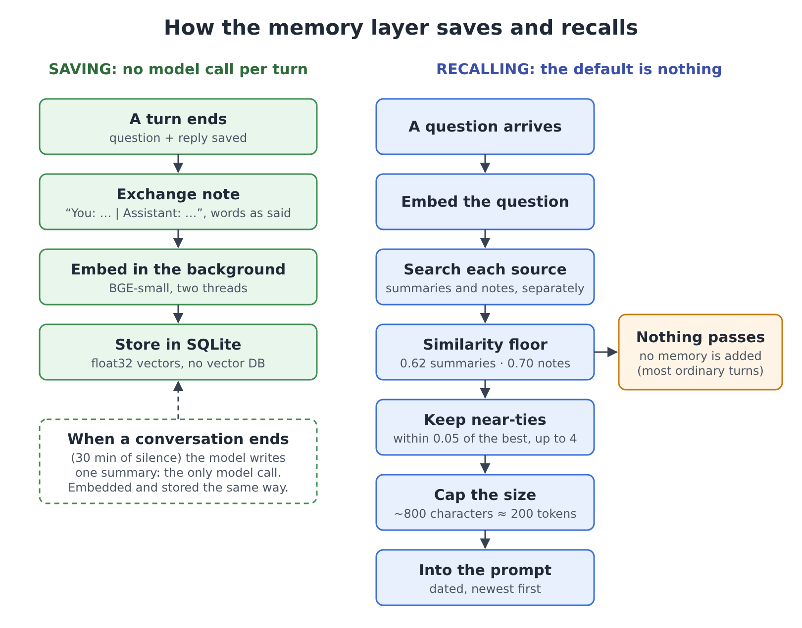

# Remember Less, Answer Better: Designing Memory for a Small Model on Low-Power Hardware

## On a CPU-only assistant, the prompt costs more than storage. So the most important thing memory can do is stay quiet.

Most writing about memory for AI assistants assumes storage is the expensive part and the prompt is cheap. You extract
facts with a model, embed them, retrieve the top few, and add them to every request. On a hosted model that is a
reasonable trade.

I build an offline voice assistant for low-power hardware: a few CPU cores, a few gigabytes of RAM, no GPU and no cloud
model. The language model is a quantized Qwen3, run in-process with llama-cpp-python, and it shares the CPU with
speech-to-text, text-to-speech, the wake word and the embedding model.

On hardware like this the trade reverses. Storage is nearly free; the prompt is where the time goes. When I measured my
first memory design, **15 of 16 ordinary questions** ("what is 2 plus 2") were getting old memories stuffed into the
prompt. After the changes in this article, it was **4 of 16**, and memory added no model calls at all.

The lesson: the most important decision a small assistant's memory makes is not what to remember, but when to stay quiet.

## The constraint

Two costs dominate a turn on a CPU.

**Prompt reading.** Before the model writes a word, it processes every token of its prompt. llama-cpp-python can reuse
the processed state of a prompt's beginning when the next prompt starts with the same tokens; on my laptop that took the
chat prompt from 14 seconds to 2.4. Recalled memory changes from turn to turn, so the cache stops where memory starts,
and everything after it is processed again in full.

**Model calls.** A small model on a CPU takes seconds per call, and every turn already needs at least one to decide
whether to answer or use a tool. A memory design that adds a call per message, to extract facts or rewrite the query,
adds that delay to every turn.

So I set two rules:

1. **Saving a memory must not need a model call of its own.**
2. **Recalled memory has a fixed budget in the prompt, and the default amount is zero.**

## What gets remembered

The assistant keeps four kinds of memory:

- **Saved facts** the user asks it to remember ("my wife's name is …"), stored as `topic: value`, capped at 40, always in
  the prompt.
- **The current conversation**, which ends after 30 minutes of silence. The last few turns are shown, trimmed to a token
  budget.
- **A one-paragraph summary of each finished conversation**, written by the model in the background. This is the only
  memory that needs a model call.
- **Exchange notes**: every question and its answer, saved as said. More on these below.

Summaries and exchange notes reach the prompt only when recall decides they are relevant. That decision is the heart of
the design.


*Saving needs no model call per turn; recalling adds nothing unless a memory clears the floor. (Diagram created with AI
assistance.)*

## The default amount of memory is zero

A vector search always returns *something*: there is always a nearest neighbor. If you add the top few results to every
prompt, an assistant that is mostly asked "set a timer" gets unrelated old conversations on almost every turn. That costs
prompt-reading time, and it costs accuracy: irrelevant context measurably degrades language-model answers, even on
grade-school math problems ([Shi et al., ICML 2023](https://arxiv.org/abs/2302.00093)).

With the similarity floor I started with (0.5), 15 of 16 ordinary questions pulled memories into the prompt. None needed
any.

The embedding model is BGE-small. Its cosine scores turned out to be squeezed into a narrow band, roughly 0.45 to 0.85.
On my data, questions that really were about the past scored 0.66 or higher against the right summary, and ordinary
questions had a median of 0.56. A floor of 0.62 sits between the two, and it cut the ordinary questions that got memory
to 4 of 16.

Three more rules came out of the same measurements:

- **A stricter floor for short texts.** Short exchange notes score higher than long summaries, so at the summary floor
  10 of 16 ordinary questions pulled in an old exchange. Exchanges got their own floor of 0.70, and the two kinds are
  searched separately so short notes can't crowd out summaries.
- **Look past rank 1, but only at near-ties.** The right summary was the top result for only 9 of 12 questions about the
  past; it was often second, a few hundredths behind. Keeping the best hit plus anything within 0.05 of it, up to four,
  put the right summary in the prompt for 10 of 12. The margin also stops the other slots filling with weaker matches.
- **A hard size limit.** Each item is cut to 280 characters and the block to about 800, roughly 200 tokens.

The whole filter fits in a few lines:

```python
hits = [h for h in hits if h.score >= floor_for(h.source)]   # 0.62 summaries, 0.70 exchanges
if hits:
    best = hits[0].score
    hits = [h for h in hits if h.score >= best - 0.05]         # near-ties of the best only
return hits[:4]                                                # then capped to ~800 characters
```

None of this is new. Similarity floors and margins are old ideas in information retrieval. What surprised me was how much
they mattered, and that the right values only came from looking at the real score distribution of the real embedding
model.

## Saving without a model: exchange notes

Summaries lose exactly the details people ask about later: the restaurant name, the number, the date. They also only
exist once a conversation is over.

A common fix is to have a model extract facts from each exchange. Mem0, for example, runs an LLM extraction step on every
new message pair ([Chhikara et al., 2025](https://arxiv.org/abs/2504.19413)). On a hosted model that's affordable; here
it would be a model call per turn.

Instead, every question and answer is saved as a short note made of the words that were actually said:

```python
def exchange_note(user, reply, user_chars=110, reply_chars=170):
    u, r = flatten(user), flatten(reply)
    if len(u) < 6 or len(r) < 6:          # "ok", "hi": nothing worth recalling
        return ""
    return f"You: {clip(u, user_chars)} | Assistant: {clip(r, reply_chars)}"
```

The note is embedded in the background, so the reply never waits for it. No model paraphrases it, so it can't misquote
what was said, though it also keeps a wrong answer if the assistant gave one. On 14 questions about specific details from
earlier conversations, the answer reached the prompt for 13 with notes and summaries together, against 12 with summaries
alone.

There is no vector database. Vectors are float32 blobs in the same SQLite file as the conversation history, and search
is one NumPy matrix product. Raw turns are deleted after 30 days, so one person's notes stay in the thousands, and a full
scan stays simple. The embedding model is about 130 MB on disk and runs on two threads, which leaves the rest of the CPU
to the language model.

Two smaller rules give memory a sense of time. Every recalled item carries its date and the newest comes first, so
"last week" means something. And "what were we talking about?", which shares no words with any summary, is recognized
by meaning and answered with the most recent conversations by date instead of by similarity.

## What it costs

Per chat turn, memory adds:

- **0 model calls.**
- **1 to 4 small embedding calls**, on two threads.
- **0 tokens** when nothing relevant is found, and **at most about 200** when something is (plus the saved facts).
- **One background embedding** after the reply, and one summary call after a conversation ends.

For scale, one decision step of the 1.7B model took a median of about 3.1 seconds on my laptop. Memory is not the main
source of latency; the model calls are. The point is that memory adds as little as possible on top, and nothing at all
on turns that don't need it.

## What isn't solved

- **The evaluation is small, and mine:** a few dozen hand-written questions over my own conversations, with thresholds
  chosen on the same data. I haven't run a public benchmark such as LoCoMo or LongMemEval.
- **The thresholds belong to one embedding model.** Swap BGE-small and every number changes; the method carries over.
- **Saved facts are never trimmed**, and changing a fact doesn't update older notes that mention the old value.
- **A summary can delay a reply** if the user speaks while it is being written, since it uses the same model.
- **English only, and shared by everyone in the household.**

## What I learned

1. **Budget prompt tokens and model calls, not storage.**
2. **Make abstaining the default.** A nearest neighbor always exists; whether it deserves a place in the prompt is a
   separate question, and for a small model the answer is usually no.
3. **Measure the embedding model you actually use.** A few dozen hand-checked questions were enough to cut unnecessary
   memory from 15 of 16 ordinary turns to 4.

If you run small models on modest hardware, I'd like to know whether these rules hold on your data, and where they break.

---

*Notes: all measurements were taken on a laptop CPU (Intel Core i5-13420H, no GPU) with low-compute settings (4-bit
model, 3,072-token context), on my own conversation data. This article was drafted with the help of Claude (Anthropic),
working from my codebase and measurements; the system, the design decisions and the measurements are my own.*
